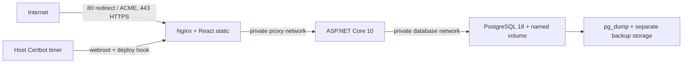

# Phase 12B — Staging Deployment & Production Readiness

Ngày kiểm chứng: **11/11/2026**. Đã chuẩn bị cấu hình và automation; **chưa triển khai lên Internet**. Không provision server/domain, không dùng hoặc sửa dữ liệu local `sles_db`.

## Trạng thái thực tế

| Hạng mục | Trạng thái |
|---|---|
| Dockerfiles, Compose, Nginx, secrets, init/upgrade/backup/rollback scripts | Implemented |
| Compose `config --quiet`, Bash/Python syntax, setup không ghi đè secrets | Passed locally |
| Official image manifests có linux/amd64 và linux/arm64, pin digest | Verified against registries |
| Backend restore/build/tests | **115/115 Passed**, 0 skipped, build 0 warnings/errors |
| Frontend npm ci/build/lint/tests | **184/184 Passed** |
| Chromium E2E trên API + PostgreSQL riêng | **15/15 Passed**, 0 skipped, 35,8 giây |
| npm audit / NuGet transitive vulnerability scan | Không phát hiện vulnerable dependencies |
| Fresh init SQL + least-privilege role, logical backup/restore + all-table counts | **Passed on local PostgreSQL**, không phải Docker |
| Staging API health/cookies/rotation/logout/rate limiting/protected routes | **Passed directly**, mô phỏng proxy qua HTTP local |
| Docker build/up/persistence/Compose backup wrapper/`nginx -t` | **Blocked**: Docker daemon không chạy; máy không có nginx binary |
| Image OS dependency scanning | **Not executed**: chưa build/pull/run image để scan |
| HTTPS certificate/renewal/real handshake/Nginx authentication | **Pending remote infrastructure**: chưa có domain/server/chứng chỉ được cấp |

Docker CLI 28.0.4 và Compose 2.34.0 có sẵn; kiểm tra ngoài sandbox vẫn báo không kết nối được Docker daemon. Registry manifest inspection không cần daemon và **không** phải bằng chứng container đã chạy. Không gọi thành công 12A/12B direct API tests là thành công qua Nginx/HTTPS.

## Kiến trúc và files



Một Linux server, Compose services `web`, `api`, `postgres`. Chỉ `web` publish port80/443; không publish5432 hoặc8080 của API. Web không tham gia mạng database. API/database nằm trong internal networks; web có thêm edge network. Bootstrap TLS chỉ phục vụ ACME/health, không phục vụ app/login trên HTTP.

Files tại `deploy/`:

- `Dockerfile.api`: official SDK10 multi-stage → official ASP.NET10 runtime, Release publish, user APP_UID không root, chỉ publish API dependencies, bỏ appsettings.Development. Health probe dùng chính .NET process, không cài curl vào runtime.
- `Dockerfile.web`: official Node22 Alpine/npm ci/build → official Nginx Alpine phục vụ dist; user nginx101, port nội bộ8080/8443. Không JWT/secret trong VITE_* hoặc image.
- `docker-compose.staging.yml`: readiness dependencies, restart unless-stopped, named volume, secrets mount, read-only API/web filesystem + tmpfs, drop capabilities/no-new-privileges, log rotation10MiB×3/service.
- `image-lock.json`: official manifest digests đã tra, platform support. FROM và postgres image pin multiarch digest, không ép platform của máy dev. Thay digest phải review/update lock và kiểm thử lại; `--pull` không tự bỏ pin.
- `nginx/nginx.conf`, `site.conf.template`, `bootstrap.conf.template`, `security-headers.conf`.
- `postgres/init.sh`; `scripts/setup.py`, `staging.sh`, `backup.sh`, `archive-counts.py`, `verify-restore.sh`, `copy-backups.sh`, `install-certificate.sh`, `smoke-https.py`.
- Root `.dockerignore` loại bin/obj/node_modules/dist/local env/secrets/backups/test artifacts và Development settings khỏi build context.

Image manifests hỗ trợ cả AMD64/ARM64; **build/run trên hai kiến trúc chưa thực thi**. Các dependencies runtime không thêm native library riêng trong phase này.

## Cấu hình và secrets

`appsettings.Staging.json` chỉ có defaults không bí mật: JSON console logs, levels, AllowedHosts localhost cho probe, rate limit. Program đọc JSON external tại `SLES_CONFIG_FILE` nếu được đặt; environment variables ưu tiên cao hơn file. Development/User Secrets/local Vite workflows giữ nguyên.

Chạy setup một lần:

```bash
cd /opt/sles/deploy
python3 scripts/setup.py --host "$STAGING_DOMAIN" --email "$ACME_EMAIL" --release "$RELEASE_ID"
```

Setup từ chối ghi đè `.env` hoặc secrets đã có. Có options `--database`, `--db-owner`, `--db-user` nếu cần tên khác mặc định. DB/role names phải là identifier hợp lệ. Các tên này và credentials **không tự đổi trên volume đã initialize** khi sửa env; rotation/rename là thao tác vận hành riêng.

| Cấu hình | Nguồn / ý nghĩa |
|---|---|
| PUBLIC_HOST | Hostname thật, không scheme/port/path; đồng thời cho Nginx và AllowedHosts |
| RELEASE_TAG | Tag riêng cho mỗi release; giữ image cũ để rollback |
| DB_NAME / DB_OWNER / DB_APP_USER | Database staging, owner/migration role, app role ít quyền |
| PROXY_SUBNET / PROXY_IP | Subnet không trùng host/VPN và static IP của Nginx; đổi cùng nhau |
| HTTP_PORT / HTTPS_PORT / BIND_ADDRESS | Mặc định80/443/0.0.0.0; chỉ web publish |
| NGINX_SITE_TEMPLATE | TLS template bình thường; command bootstrap-tls override tạm bằng ACME-only template |
| BACKUP_DIR / BACKUP_KEEP | Đích backup và số archive giữ lại, mặc định7 |
| AuthenticationRateLimit__PermitLimit | Mặc định30 login/refresh mỗi phút/IP trong Staging, queue0 |
| secrets/api-settings.json | ConnectionStrings:DefaultConnection, Jwt issuer/audience/signing key, BootstrapAdmin |
| secrets/pg-admin-password | Password owner/superuser của PostgreSQL image, không mount vào API |
| secrets/app-db-password | Password app role; init dùng để tạo role, API dùng cùng giá trị trong JSON |

JWT signing key sinh bằng CSPRNG64bytes; password ngẫu nhiên riêng. Source appsettings không có signing key/bootstrap password. `.env` chỉ chứa cấu hình không bí mật và có mode0600; `secrets/` mode0700. File-backed Compose secrets giữ host mode: từng file mode0444 để UID không root trong container đọc được file được mount riêng; host users khác không đi qua thư mục0700. Đây không phải encrypted secret manager; bảo vệ host/Docker access và backup secrets riêng. Không chmod thư mục secrets thành world-readable. `web` không nhận secrets app/DB.

Không log password/access token/refresh token hoặc request body/header. Không bật EF sensitive data logging. Access token frontend vẫn chỉ ở memory; refresh cookie HttpOnly, Secure ngoài Development, SameSite=Lax, Path=/api/auth. Rotation/logout không đổi nghiệp vụ.

Admin bootstrap chỉ tạo nếu chưa có Admin. Lấy password từ secret file bằng trình soạn thảo bảo mật, không cat/paste vào logs. Login qua HTTPS, đổi password bắt buộc rồi chạy:

```bash
./scripts/staging.sh seal-bootstrap
```

Lệnh bỏ BootstrapAdmin khỏi secret JSON và recreate API. Secret files không tự reload trong process; khi rotation phải recreate service liên quan và kiểm tra login.

## Nginx, proxy và HTTPS

SPA routes fallback index.html; assets hashed cache dài/immutable, index không cache. `/api/*` proxy_pass giữ nguyên URI, không strip `/api`. Nginx nhận tối đa5MiB để chứa multipart overhead; application vẫn giữ limit file4MiB và request4MiB+64KiB. Timeout proxy65giây. Không expose health dependencies qua public Nginx.

Nginx ghi access log gồm request ID, remote IP, method, URI path, status, duration; không query strings/headers/cookies/bodies. Security headers nosniff, frame DENY, Referrer-Policy, Permissions-Policy áp dụng cả locations có Cache-Control. Chưa bật HSTS. TLS1.2/1.3, không self-signed certificate cho public staging.

Nginx **ghi đè** X-Forwarded-For bằng remote_addr, X-Forwarded-Proto bằng scheme, Host bằng PUBLIC_HOST; không nối header do Internet client cung cấp. API chỉ tin loopback nội bộ và IP proxy được cấu hình, ForwardLimit1; không bật ASPNETCORE_FORWARDEDHEADERS_ENABLED hoặc wildcard CORS. ForwardedHeaders chạy trước HTTPS redirect; `/health` không redirect. Các giới hạn trust theo [ASP.NET Core proxy guidance](https://learn.microsoft.com/en-us/aspnet/core/host-and-deploy/proxy-load-balancer?view=aspnetcore-10.0).

Chọn duy nhất **host Certbot webroot**, Nginx container là TLS terminator. Certbot lưu `/etc/letsencrypt`; deploy hook copy certificate/key vào `state/tls` uid/gid101, dir0750/files0640 (nằm dưới host state/0700), rồi nginx -t/reload. Không cài thêm host Nginx hoặc layer TLS thứ hai. Renewal bằng certbot.timer và hook cố định, theo [Certbot renewal guidance](https://eff-certbot.readthedocs.io/en/stable/using.html#renewing-certificates).

## PostgreSQL initialization và upgrade

Official PostgreSQL18 dùng PGDATA `/var/lib/postgresql/18/docker` và mount named volume tại **/var/lib/postgresql**, không dùng mount convention cũ `/var/lib/postgresql/data`. Đã đối chiếu [official PostgreSQL image](https://hub.docker.com/_/postgres).

Entrypoint chỉ chạy init.sh khi PGDATA mới/rỗng. Script tạo app role LOGIN nhưng NOSUPERUSER/NOCREATEDB/NOCREATEROLE/NOREPLICATION; tạo schema v1.2 rồi difficulty migration, grant DML/sequence usage/schema usage. API không sở hữu schema và không có quyền DDL. Owner role chỉ dành initialization/migration/backup.

Restart không reinitialize và không xóa dữ liệu. Không có down -v/prune volume trong scripts. Nếu init bị gián đoạn, kiểm tra log và trạng thái schema; không chạy lại schema.sql hoặc xóa volume để “sửa nhanh”.

Repo dùng raw SQL migrations, không thêm EF migration/business schema mới. Trạng thái được **verify cấu trúc** (difficulty + legacy_difficulty và CHECK bốn mã), không tạo migration tracking table:

```bash
./scripts/staging.sh schema-check
```

Upgrade database v1.2 đã tồn tại, chỉ khi operator xác nhận đúng database và backup:

```bash
./scripts/staging.sh migrate-difficulty
```

Lệnh backup, dừng writers web/api, chạy riêng migration up, verify schema, start. Không chạy destructive baseline trên DB đang có dữ liệu. Rollback difficulty theo hướng dẫn QuestionDifficultyAndBulkPublish.md; các câu mới cần legacy values được review trước down. Script rollback release **không** tự downgrade schema/restore data.

## Lệnh triển khai remote

Các lệnh dưới đây **chưa được thực thi trên remote**. Chỉ chạy sau khi có server, quyền quản trị, domain và phê duyệt triển khai. Không có tài nguyên trả phí nào được tạo trong lượt này.

Ví dụ chọn **Ubuntu24.04 LTS** cho VPS/EC2. Chuẩn bị server và DNS A → IPv4 public; chỉ thêm AAAA nếu đã cấu hình IPv6 end-to-end. Security group/firewall inbound:80/443 công khai, SSH chỉ CIDR quản trị; không mở5432/8080. Docker published ports có thể bypass UFW; kiểm soát cả security group/DOCKER-USER, không chỉ UFW. Cài đặt theo [Docker Ubuntu guide](https://docs.docker.com/engine/install/ubuntu/):

```bash
sudo apt-get update
sudo apt-get install -y ca-certificates curl python3 rsync certbot
sudo install -m 0755 -d /etc/apt/keyrings
sudo curl -fsSL https://download.docker.com/linux/ubuntu/gpg -o /etc/apt/keyrings/docker.asc
sudo chmod a+r /etc/apt/keyrings/docker.asc
printf 'deb [arch=%s signed-by=/etc/apt/keyrings/docker.asc] https://download.docker.com/linux/ubuntu %s stable\n' \
  "$(dpkg --print-architecture)" "$(. /etc/os-release; echo "$VERSION_CODENAME")" | sudo tee /etc/apt/sources.list.d/docker.list
sudo apt-get update
sudo apt-get install -y docker-ce docker-ce-cli containerd.io docker-buildx-plugin docker-compose-plugin
sudo systemctl enable --now docker
sudo docker version
sudo docker compose version
```

Copy repository/release vào `/opt/sles`, gồm `deploy`, API/frontend source, `database` và `database/SLES_Database_v1_2.sql`. Không copy local .env, User Secrets, node_modules/bin/obj/backups. Quyền Docker tương đương quyền quản trị host; các lệnh tiếp theo chạy trong shell đã được cấp quyền Docker. Release scripts và certbot hook phải do administrator kiểm soát.

```bash
# Trên server, điền domain/email/release thật; không nhập secrets vào shell history.
export STAGING_DOMAIN='your-real-staging-domain'
export ACME_EMAIL='your-operator-email'
export RELEASE_ID='your-unique-release-id'
cd /opt/sles/deploy
python3 scripts/setup.py --host "$STAGING_DOMAIN" --email "$ACME_EMAIL" --release "$RELEASE_ID"
docker compose --env-file .env -f docker-compose.staging.yml config --quiet
./scripts/staging.sh build
./scripts/staging.sh bootstrap-tls
./scripts/staging.sh status
./scripts/staging.sh schema-check

# Persist renewal hook. The script only handles this configured certificate lineage.
sudo install -d -m 0755 /etc/letsencrypt/renewal-hooks/deploy
sudo tee /etc/letsencrypt/renewal-hooks/deploy/sles >/dev/null <<'HOOK'
#!/usr/bin/env bash
exec /opt/sles/deploy/scripts/install-certificate.sh
HOOK
sudo chmod 0750 /etc/letsencrypt/renewal-hooks/deploy/sles
sudo certbot certonly --webroot -w /opt/sles/deploy/state/acme \
  --cert-name "$STAGING_DOMAIN" -d "$STAGING_DOMAIN" -m "$ACME_EMAIL" --agree-tos --non-interactive
# Explicit first install is idempotent even if certbot already invoked the hook.
sudo /opt/sles/deploy/scripts/install-certificate.sh
./scripts/staging.sh nginx-test
curl --fail --head "https://$STAGING_DOMAIN/"
# Must return a redirect to https for normal app paths.
curl --head "http://$STAGING_DOMAIN/"
# Login in browser, change bootstrap password, then:
./scripts/staging.sh seal-bootstrap
python3 scripts/smoke-https.py "https://$STAGING_DOMAIN"
sudo systemctl enable --now certbot.timer
sudo certbot renew --dry-run
```

smoke-https.py dùng TLS verification mặc định, không có --insecure; hỏi password qua getpass, không log token. Nó kiểm tra frontend, SPA refresh route, unauthorized401, login, protected route, Secure/HttpOnly cookie, refresh rotation/logout. Chỉ dùng tài khoản kiểm thử riêng. Dry-run certbot không thay thế việc kiểm tra renewal thật/reload trên domain thật.

Xác minh readiness từ bên trong network:

```bash
docker compose --env-file .env -f docker-compose.staging.yml exec -T api dotnet SLES.Api.dll --health-check
./scripts/staging.sh status
./scripts/staging.sh logs api
```

Sau khi Docker chạy, cần làm smoke persistence: ghi nhận counts/test records, restart containers, đối chiếu lại; upload Excel hợp lệ và vượt4MiB bằng teacher test; kiểm tra public port exposure và host headers. Các bước này hiện **blocked**, chưa có kết quả pass.

## Vận hành, upgrade và rollback

```bash
cd /opt/sles/deploy
./scripts/staging.sh start
./scripts/staging.sh stop       # Giữ nguyên volume
./scripts/staging.sh restart
./scripts/staging.sh status
./scripts/staging.sh logs api   # Hoặc web/postgres, tối đa100 dòng
./scripts/staging.sh backup
./scripts/staging.sh upgrade 'new-unique-release-tag'
./scripts/staging.sh rollback 'known-compatible-previous-tag'
```

Upgrade backup trước, build tag mới, chỉ recreate api/web và chờ health; không tự thay PostgreSQL container/schema. Tag đã tồn tại bị từ chối để bảo toàn rollback image. .env/current release chỉ cập nhật sau success, previous tag ở state/previous-release. Nếu health fail, giữ log và rollback explicitly về tag đã biết; không tự restore database. Rollback không build/pull và chỉ dùng image cũ đã có; cần operator xác nhận schema tương thích. Không chạy image prune xóa rollback images trong thời gian giữ release.

Pin base image digests giúp replay build cùng base; dependency source/lockfiles phải giữ theo release. Image registry/supply-chain scan và triển khai cả hai kiến trúc chưa được runtime-verify. Update base image lock định kỳ sau review security, không để pin làm bỏ qua bản vá.

## Backup, restore và off-server copies

```bash
./scripts/backup.sh
./scripts/verify-restore.sh '/absolute/path/to/backup.dump'
./scripts/copy-backups.sh 'backup-user@backup-host:/secure/sles-backups'
```

Backup dùng pg_dump custom, timestampUTC+PID, file.partial chỉ đổi tên khi dump/TOC kiểm tra thành công; destination0700, files0600. Manifest row counts sinh từ COPY records trong **chính archive snapshot**, không từ live tables đang thay đổi. Lỗi trả exit nonzero/stderr; không xóa bản cũ trước khi backup mới thành công. Retention mặc định7 successful archives; chạy daily sẽ giữ7 daily copies. Nếu backup thủ công nhiều lần/ngày, điều chỉnh BACKUP_KEEP phù hợp.

Ví dụ cron daily trên server (administrator tự đặt alert cho exit/error):

```cron
15 2 * * * /opt/sles/deploy/scripts/backup.sh
```

verify-restore tạo DB `sles_restore_<timestamp>_<pid>` riêng, restore --exit-on-error, query bảng nghiệp vụ dưới app role, so sánh counts mọi bảng public trong archive, rồi drop đúng DB test trong EXIT trap. Không restore lên live DB. Chỉ restore archive tin cậy; pg_restore thực thi objects/SQL trong backup.

Backup local cùng server **không** bảo vệ khi mất server/disk. copy-backups dùng SSH/rsync, không --delete remote; cấu hình SSH keys/known_hosts ngoài repo, lên lịch copy và retention/encryption ở nơi lưu riêng. Backup chứa dữ liệu học sinh và password hashes, phải giới hạn quyền truy cập. Secrets/certificates cần quy trình backup riêng bảo mật; database dump không chứa login roles/passwords của PostgreSQL.

Disaster recovery: tạo PostgreSQL/roles sạch trước; restore vào database recovery mới, kiểm tra counts/quyền bằng app role, đổi DB_NAME và ConnectionStrings trong secret JSON sang recovery DB, recreate API, chạy health/auth/E2E smoke. Không chạy baseline SQL vào target recovery đã restore, không restore đè live và không xóa DB cũ tự động. Ví dụ core restore commands, khi đã dừng writers và có owner role:

```bash
# Set explicit operator-reviewed names/paths; never use a live DB as RECOVERY_DB.
export RECOVERY_DB='sles_recovery_reviewed'
export BACKUP_FILE='/secure/path/to/reviewed.dump'
# Load the operator-owned configuration to obtain DB_OWNER.
set -a; source .env; set +a
docker compose --env-file .env -f docker-compose.staging.yml exec -T postgres createdb -U "$DB_OWNER" "$RECOVERY_DB"
docker compose --env-file .env -f docker-compose.staging.yml exec -T postgres \
  pg_restore -U "$DB_OWNER" -d "$RECOVERY_DB" --no-owner --exit-on-error < "$BACKUP_FILE"
```

Không tự đổi DB target trong scripts vì đây là bước cutover cần operator đối chiếu dữ liệu và cấu hình.

## Health và logging

- `/health/live`: process sống, không query DB.
- `/health/ready`: app role đọc được questions.difficulty và legacy_difficulty; sai connection/quyền/schema →503, không trả chi tiết cấu hình.
- API Docker HEALTHCHECK gọi ready bằng HttpClient qua loopback8080; Nginx private probe HTTP/healthz; PostgreSQL pg_isready.
- JSON logs có UTC timestamp/scopes, server-generated X-Correlation-ID; Staging generic500 response kèm correlationID, không Development exception page. OpenAPI chỉ Development.
- Auth login/refresh limit30/phút/IP, không queue,429; cấu hình theo lưu lượng/NAT thực tế. Header trust test đảm bảo client lạ không giả proxy để đổi IP/scheme.
- Không thêm observability stack lớn; log rotation Compose10MiB×3/service. Cần alert ngoài ứng dụng cho health/backup/renewal/disk.

## Security checklist

| Kiểm tra | Kết quả / giới hạn |
|---|---|
| Credentials trong source appsettings | Không có JWT signing key/bootstrap password; secrets sinh ngoài repo |
| Public DB/API ports | Không có trong Compose; runtime exposure chưa kiểm chứng |
| App database role | Không superuser/createdb/createrole/replication; init và app-role queries tested |
| Runtime user | API APP_UID và Nginx101, read-only, cap_drop; container execution blocked |
| Forwarded headers | Chỉ configured proxy/loopback, limit1; trusted/untrusted regression passed |
| Cookies/rotation/logout | Direct Staging test passed; Nginx+HTTPS pending |
| Auth rate limiting | Staging429 đã kiểm thử |
| Upload limit | Existing4MiB app limit giữ; Nginx5MiB configured, proxy runtime pending |
| Exception/OpenAPI/CORS | Không Dev page/OpenAPI Staging; không thêm wildcard CORS |
| TLS/HSTS | Let's Encrypt automation prepared; cert/handshake pending; HSTS chưa bật |
| Dependency scans | npm/NuGet sạch theo nguồn hiện tại; OS image scan chưa chạy |
| Backups | Local logical restore verified; Compose wrapper/offsite cron pending runtime |

## Kiểm chứng đã thực thi và giới hạn readiness

`deploy/tests/local_staging.py` tạo source DB/restore DB/role UUID riêng, chạy **init.sh thực tế với mount paths được đổi sang host paths**, seed deterministic records, dump/restore, so sánh counts tất cả COPY tables, query bằng app role. Chạy API Staging đối với DB restore, kiểm tra login/auth/refresh/logout, flags cookie, correlation,429; revoke SELECT để ready503 trong khi live200, grant lại ready200; OpenAPI404. Cuối test dừng đúng process và xóa DB/role test. Đây là bằng chứng logical backup/restore và app settings, không phải volume persistence hoặc Compose wrapper đã chạy.

Full regression đã chạy lại; không dùng kết quả báo cáo cũ để suy ra pass. Setup được chạy trong thư mục tạm để kiểm tra quyền/secrets/không overwrite. Các SQL role/database kiểm thử đã cleanup. Local sles_db và API dev đang chạy không bị reset/redeploy.

Chi phí: thiết kế một server, một API, một PostgreSQL và static Nginx; không thêm managed database/cluster/observability stack. Đo RAM/CPU peak khi build và tải người dùng trước khi chọn kích cỡ VPS; dung lượng volume/backup và off-server storage là phần phải tính. Một server không có HA; local backups không thay thế off-server recovery.

**Chưa chứng nhận production-ready và chưa xác nhận deployment staging hoàn tất.** Phần preparation/application regression đã hoàn thành; còn Docker build/up/nginx -t, persistence/Compose restore smoke, image scan và domain HTTPS thực. Chỉ sau các bước đó mới đánh giá staging/UAT và production gaps (load, đa instance/import store, monitoring, recovery drills, security review).
